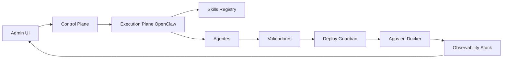
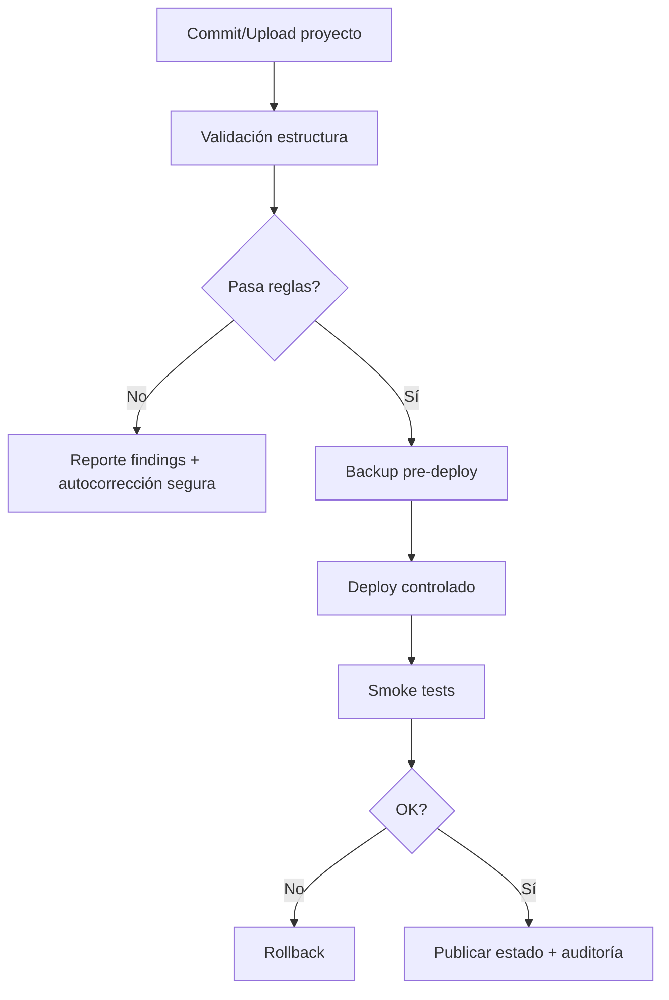
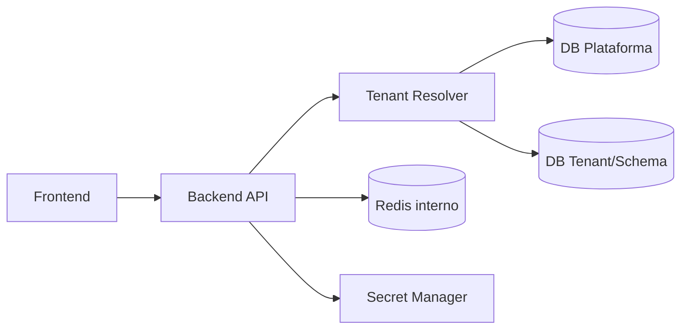
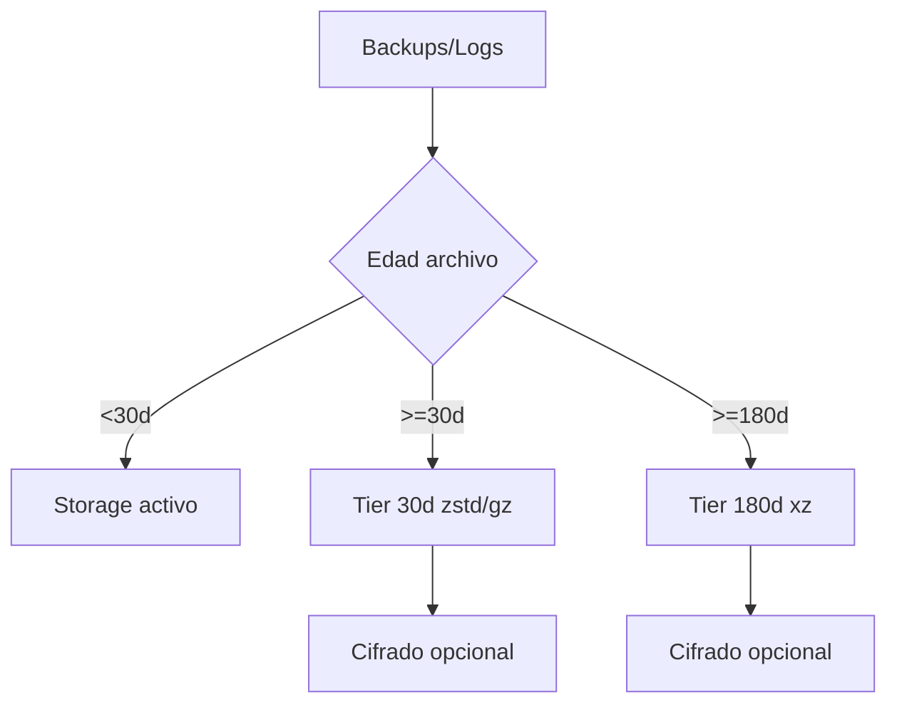
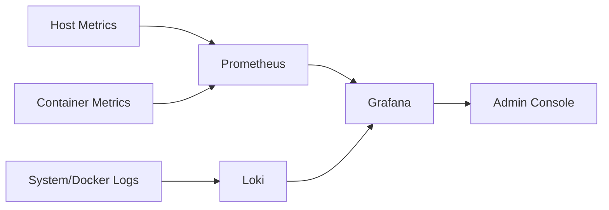

# Diagramas de Arquitectura y Operación

## 1) Flujo general de plataforma

## 2) Flujo de validación + despliegue

## 3) Flujo de datos multi-tenant

## 4) Lifecycle de archivado

## 5) Monitoreo visual

